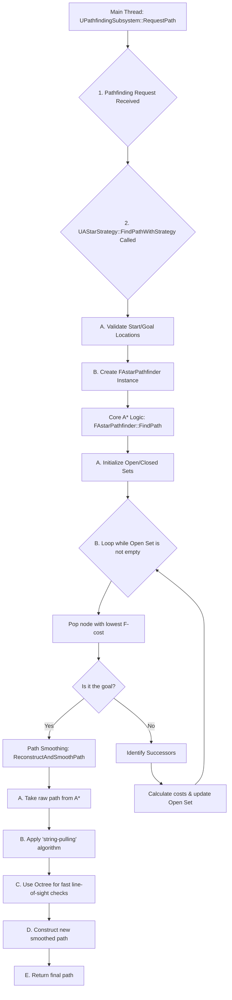

## **Smart Flying Navigation Plugin - Technical Documentation**

### 1. Overview

This 3D navigation plugin is a high-performance, integrated navigation solution designed to enable multiple agents to move to their destinations efficiently and naturally within complex 3D environments. The plugin is composed of two core systems: a **Hierarchical Pathfinding System** for the static environment and an **Asynchronous Avoidance System** for avoiding collisions between dynamic agents.

The roles of the two systems are clearly delineated:

*   **Pathfinding System (Macro-level Path Planning):** Answers the question, "Where should I go?" It generates an optimal list of waypoints to the destination by executing an A\* algorithm on pre-computed Octree data.
*   **Avoidance System (Micro-level Movement Decision):** Determines, "How can I get there safely?" It takes the `Preferred Velocity`—the desire to follow the path generated by the pathfinding system—as input and calculates a final velocity that avoids nearby agents and terrain in real-time.

Thus, the responsibility of the pathfinding system ends with providing an optimal 'path', while the avoidance system determines the actual 'movement' based on the intent to follow that path. These two systems are organically linked through a clear data interface, the `Preferred Velocity`, allowing agents to follow a high-level path through complex terrain while naturally avoiding obstacles they encounter in real-time.

---

### 2. Integrated System Architecture

All agent movement is orchestrated by the **`UPathfindingComponent`** attached to an actor, operating through the tight interplay of the pathfinding and avoidance systems.

1.  **Path Request:** The `UPathfindingComponent` requests a path to a destination from the **Pathfinding Subsystem (`UPathfindingSubsystem`)**.
2.  **Path Generation:** The pathfinding system generates an optimal path (a list of Waypoints) based on pre-baked Octree data, using A\* search and Lazy Theta\* smoothing, and returns it to the component.
3.  **Preferred Velocity Calculation:** Every frame, the `UPathfindingComponent` calculates a **`PreferredVelocity`** pointing towards the next waypoint on its path. This is the ideal velocity the agent wishes to have, without considering any avoidance.
4.  **Provide Avoidance Data:** The `UPathfindingComponent` registers itself with the `UAvoidanceSubsystem` and provides its calculated `PreferredVelocity`, current position, radius, and other information to the avoidance system every frame.
5.  **Asynchronous Avoidance Calculation:** The avoidance system gathers data from all registered agents, performs avoidance calculations based on the **ORCA algorithm on a Worker Thread**, and computes the constraints needed to avoid collisions.
6.  **Apply Final Velocity:** The results of the avoidance calculation (the constraints) are passed back to the main thread. The avoidance subsystem applies these constraints to the `PreferredVelocity` to compute a **`FinalOptimalVelocity`** that avoids all collisions. This velocity is then applied to the agent's actual movement after interpolation and a final stabilization (Sweep) check.

```mermaid
graph TD
    subgraph "Agent (UPathfindingComponent)"
        A[1. Request Path] --> B(Pathfinding Subsystem);
        C[3. Receive Path (Waypoints)] --> D[4. Follow Path<br>(Calculate Preferred Velocity)];
        D --> E(Provide Data to Avoidance Subsystem);
        F[7. Receive & Apply Final Optimal Velocity] --> G(Move Actor);
    end

    subgraph "Pathfinding System"
        B --> H{2. Generate Path<br>(A* on Octree)};
        H --> C;
    end

    subgraph "Avoidance System"
        E --> I[5. Collect Data from All Agents];
        I --> J{6. Async Avoidance Calculation<br>(Worker Thread)};
        J --> F;
    end
```

---

### 3. Hierarchical Pathfinding System

This system is the first stage of navigation, responsible for generating efficient and natural long-distance paths for agents in large, complex 3D worlds.

#### 3.1. Key Classes and Structs

*   **`AOctreeVoxelVolume`**: An `AActor` that defines the bounds of the navigable space. It manages the entire Octree data structure (`StaticNodePool`) and the dynamic obstacle grid (`DynamicObstacleBitmask`), and provides editor functionality to bake the static world geometry into a `UOctreeDataAsset`.
*   **`UAStarStrategy`**: The public-facing interface for the pathfinding system. It receives an `FPathfindingRequest` and orchestrates the pathfinding process by creating and running an `FAstarPathfinder`.
*   **`FAstarPathfinder`**: The core worker class that implements the A\* search algorithm. It manages the Open/Closed Sets, and the path reconstruction and smoothing process. It is designed to be a transient object, created for each pathfinding request.
*   **`FOctreeNode`**: The fundamental data structure of the Octree. It contains its state (`Empty`, `Solid`, `Mixed`), bounds, and precomputed links to its 8 children and 6 face-adjacent neighbors, which drastically accelerates traversal.

#### 3.2. Algorithm Details

##### **3.2.1. Offline Data Generation (Baking)**



1.  **Scanning (`ScanForAllStaticObstacles`)**: In the editor, the volume first scans for all static geometry within its bounds that matches a specified collision profile.
2.  **Voxelization & Insertion (`InsertObstacleRecursive`)**: Each static mesh is voxelized. For each obstacle voxel, the system traverses the Octree from the root, recursively subdividing nodes (`Empty` -> `Mixed`). Upon reaching the maximum depth, the corresponding leaf node is marked as `Solid`.
3.  **Optimization & Merging (`OptimizeAndCollapse`)**: After all obstacles are inserted, the tree is traversed bottom-up. If all 8 children of a `Mixed` node are of the same state (e.g., all `Solid`), the parent node is "merged" into that state, and the children are pruned, significantly reducing the node count.
4.  **Neighbor Precomputation (`PrecomputeNeighbors`)**: For every leaf node in the final tree, its 6 face-adjacent neighbors are found and their indices are stored. This transforms a slow, spatial search at runtime into a simple, O(1) array lookup, which maximizes A\* performance.

##### **3.2.2. A\* Pathfinding and Path Smoothing (Lazy Theta\*)**

*   **A\* Search**: The `FAstarPathfinder` executes an A\* search, treating the leaf nodes of the Octree as a graph. The Open Set is implemented as a Min-Heap using `TArray`'s `HeapPush`/`HeapPop` for O(log n) performance. Neighbor discovery is nearly instantaneous thanks to the precomputed neighbor array. For performance, both the **Heuristic** and **Movement Cost** use the **squared Euclidean distance** to avoid costly square root operations.
*   **Path Smoothing (`ReconstructAndSmoothPath`)**: This function smooths the angular path from A\* using a "string-pulling" algorithm. Starting from the beginning of the path, it uses the Octree to quickly check for the furthest node that can be reached by a cylindrical volume (defined by the agent's radius) without obstruction. This point is added to the final path, and the process repeats from that point, resulting in a smooth path with a minimum number of waypoints.

---

### 4. Asynchronous Avoidance System

This is the second stage of navigation, responsible for adjusting the real-time movement of agents following a path to ensure they do not collide with each other or the static environment.

#### 4.1. Key Classes and Structs

*   **`UAvoidanceSubsystem`**: The main class, inheriting from `UTickableWorldSubsystem`. It manages agents, async tasks, and applies results.
*   **`FParallelAvoidanceTask`**: An async task (`FNonAbandonableTask`) that performs avoidance calculations in the background, freeing up the game thread.
*   **`FAgentThreadData`**: A struct for passing agent info (ID, Position, Velocity, etc.) to the worker thread.
*   **`FThreadAvoidanceResult`**: A struct for passing calculation results (constraints, adjusted velocity) back to the main thread.

#### 4.2. Algorithm Details

##### **4.2.1. Asynchronous Avoidance Calculation (`RunAvoidanceCalculation`)**

1.  **Spatial Grid Creation (Neighbor Search Optimization)**: To avoid an O(n²) comparison, the 3D space is divided into a grid. Each agent is registered to the cells it occupies, and neighbor searches only consider agents in the same or adjacent cells, drastically reducing the computational load.
2.  **Constraint Generation**:
    *   **Symmetry Breaking (`CalculateSymmetryBreakingVelocity_ThreadSafe`)**: When two agents are on a head-on collision course, this logic decides which one should yield to prevent a deadlock. The rules are: the agent with the **smaller radius** yields; if radii are equal, the agent with the **higher preferred velocity** (the one intending to move faster) yields. A lateral velocity is added to the yielding agent's preferred velocity to make it swerve naturally.
    *   **Agent Constraints**: Following the ORCA algorithm, it predicts future collisions with neighboring agents (Velocity Obstacle) and generates a plane (`FPlane`) constraint to avoid it.
    *   **Static Obstacle Constraints**: It uses `SweepMultiByObjectType` to detect static geometry (walls, etc.) on the agent's path and generates a plane constraint to prevent movement in that direction.

##### **4.2.2. Optimal Velocity Solving and Final Application**

1.  **Two-Step Velocity Solving**: For stability, constraints are resolved in a specific order. A collision with **static terrain is a non-negotiable 'Hard Constraint'**, whereas a collision with **another agent is a 'Soft Constraint' that can be mutually resolved.** Therefore, the system first resolves static obstacle constraints to guarantee a **`SafeVelocity`** within the world, and then uses that velocity as a base to resolve agent constraints, calculating the final **`FinalOptimalVelocity`**.
2.  **Velocity Interpolation (`FMath::VInterpTo`)**: Applying the `FinalOptimalVelocity` immediately can cause jerky movement. It is therefore smoothly transitioned from the agent's current velocity to the target velocity based on the `InterpSpeed` value.
3.  **Final Stabilization (Sweep & Slide)**: Before moving the agent, a final `SweepSingleByChannel` check is performed along the interpolated velocity path. If a collision is predicted, the agent moves only to the point of impact, and its velocity is re-projected to slide along the impact surface for the remainder of the frame. This step prevents agents from getting stuck in or passing through geometry, significantly improving system robustness.

---

### 5. How to Use

1.  **Place Volume and Bake Data:**
    *   Place an `AOctreeVoxelVolume` actor in the level and scale it to cover the entire navigable area.
    *   In the editor, select the volume and click the "Bake Static Data" button in its Details panel to generate the static navigation data.
2.  **Add Component and Register:**
    *   Add a `UPathfindingComponent` to any actor that requires navigation.
    *   In the component's `BeginPlay`, get the `UAvoidanceSubsystem` and call the `RegisterAgent` function to register itself with the avoidance system.
3.  **Request Path and Move:**
    *   When movement is needed, call a function like `RequestPath` on the `UPathfindingComponent` with a target destination.
    *   The component will internally handle following the path, calculating `PreferredVelocity`, interacting with the avoidance system, and moving the parent actor with the final calculated velocity.
4.  **Unregister Component:**
    *   When the actor is destroyed, the component's `EndPlay` will automatically call `UnregisterAgent` to remove it from the avoidance system.

---

### 6. Tuning Parameters

#### 6.1. Pathfinding System (`AOctreeVoxelVolume`, `UAStarStrategy`)

*   `MaxOctreeDepth`: The maximum depth of the Octree. Higher values mean more precision but also more memory usage. (Default: `7`)
*   `NearbyGoalSearchRadius`: The radius to search for an alternative valid goal if the original goal is unreachable. (Default: `500.f`)

#### 6.2. Avoidance System (`UAvoidanceSubsystem`)

*   `TimeHorizon`: How many seconds into the future to predict collisions for avoidance. (Default: `1.f`)
*   `MaxNeighbors`: The maximum number of neighbors an agent will consider for avoidance calculations. (Default: `8`)
*   `GridCellSize`: The size of a cell in the spatial grid used for neighbor searching. (Default: `100.f`)
*   `InterpSpeed`: Determines how smoothly the calculated optimal velocity is blended with the agent's current velocity. (Default: `10.f`)

---

### 7. Debugging

*   **Pathfinding Debugging:** Enable debug drawing on the `AOctreeVoxelVolume` actor to visualize the Octree structure.
    *   **Solid Nodes (Red):** Impassable static geometry.
    *   **Empty Nodes (Green):** Open, traversable space.
    *   **Mixed Nodes (Yellow):** Parent nodes that contain both empty and solid children.
*   **Avoidance Debugging:** Set `bShowVelocityDebugLine` to `true` in the `UAvoidanceSubsystem` to visually debug the velocities of each agent.
    *   **Blue:** `PreferredVelocity` - The ideal velocity determined by the pathfinding logic.
    *   **Yellow:** `ActualPreferredVelocity` - The preferred velocity after symmetry-breaking logic has been applied.
    *   **Red:** `FinalOptimalVelocity` - The final calculated velocity after all constraints have been resolved.